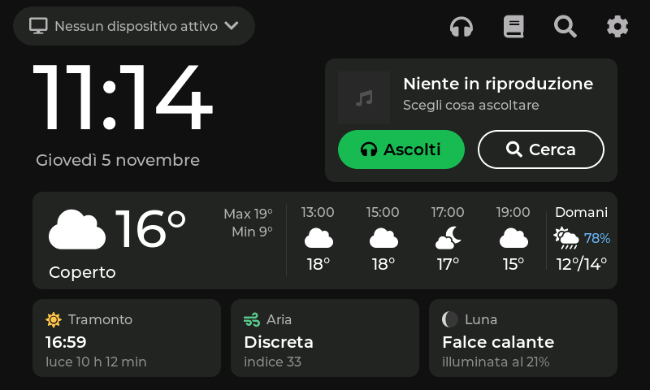
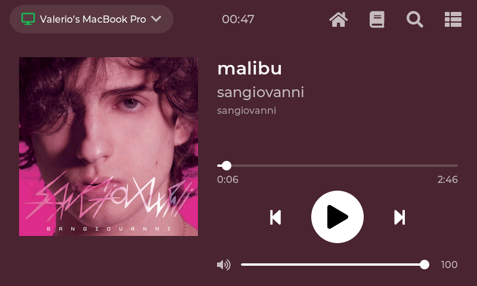
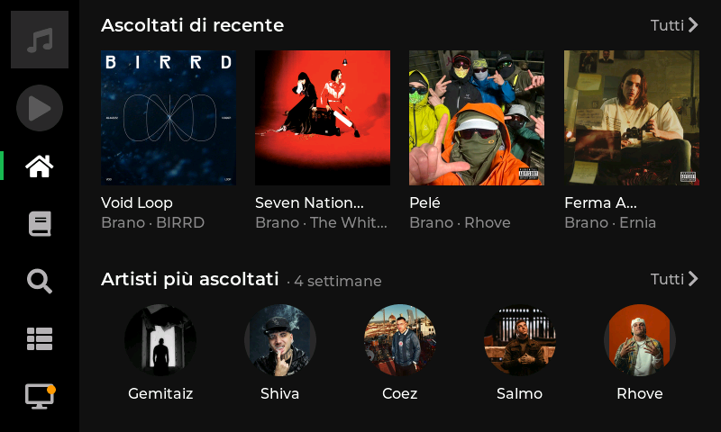
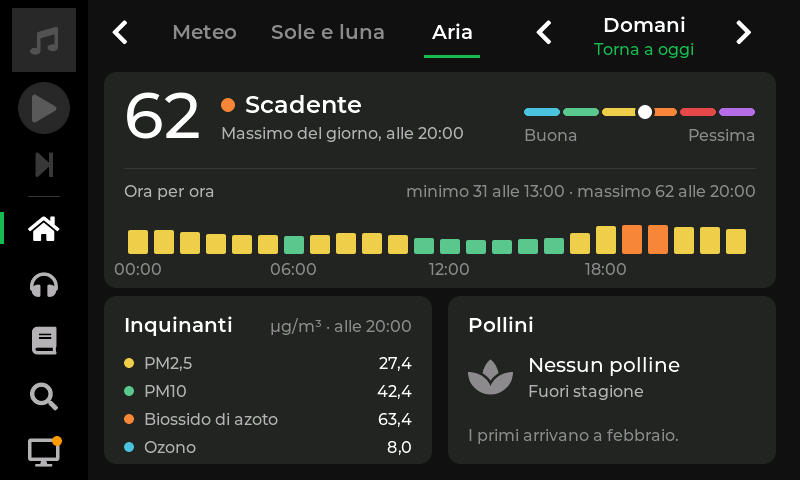

# Controller Spotify ESP32

*[Read in English](README.md)*

Uno schermo touch da 5" da tenere accanto al computer come **telecomando e cruscotto di Spotify**: cosa suona, i comandi, la libreria, la ricerca, la coda e i dispositivi. La sua Home mostra anche l'ora, il meteo, alba e tramonto, la luna e la qualità dell'aria.

La scheda non riproduce mai l'audio. La musica continua a uscire dal computer, dal telefono o dalle casse: lo schermo manda solo i comandi tramite la [Web API di Spotify](https://developer.spotify.com/documentation/web-api) (serve un account **Premium**).

| Home | In riproduzione |
|---|---|
|  |  |
| **Ascolti (Home di Spotify)** | **Qualità dell'aria, qualsiasi giorno** |
|  |  |

Le foto sono prese direttamente dalla scheda.

## Cosa fa

- **In riproduzione**: copertina, titolo, artista, avanzamento, play/pausa, brano precedente e successivo, volume. Il fondo prende i colori della copertina.
- **Libreria**: playlist, brani piaciuti, album e artisti seguiti, a pagine, con il menu del brano.
- **Ricerca** (brani, album, artisti, playlist), **coda** e **scelta del dispositivo**.
- **Ascolti** (Home di Spotify): ascoltati di recente, artisti e brani più ascoltati.
- **Home** a riquadri: l'ora, un riquadro Spotify con ⏮ ⏯ ⏭ (toccandolo si apre la schermata del brano), e:
  - **meteo** di adesso e delle prossime ore, da [Open-Meteo](https://open-meteo.com/) (gratuito, senza chiave). La posizione si ricava dalla connessione, oppure è la città predefinita del tuo elenco;
  - **sole e luna**: alba, tramonto, ore di luce, indice UV, fase della luna;
  - **aria**: indice europeo della qualità dell'aria, inquinanti e pollini.
- **Stato del computer**: un piccolo programma sul Mac (`strumenti/ponte_computer.py`) manda via Wi-Fi ogni 5 secondi batteria, processore, memoria, disco e batteria delle cuffie. Un riquadro della Home mostra la batteria, oppure un avviso (batteria scarica, disco quasi pieno, caldo…); toccandolo si apre una pagina con tutti i dati.
- **Città**: cerchi qualsiasi città con la tastiera sullo schermo, ne tieni fino a 8 in un elenco con la temperatura di adesso, con la stella scegli la predefinita della Home, e dalla pagina Meteo guardi un'altra città al volo.
- **Qualsiasi giorno da 7 giorni fa a 7 giorni avanti** per meteo, sole e luna, aria (l'aria solo fino a 4 giorni avanti): con le frecce o scorrendo col dito.
- **Brano successivo** e play/pausa sempre a portata nella barra laterale di ogni pagina.
- **Impostazioni**: rete Wi-Fi e segnale, impronta del firmware e indirizzo IP.
- **Luce dello schermo**: 100%, poi 15% dopo 2 minuti senza tocchi (e si torna alla Home), spenta dopo 12.
- **Wi-Fi impostato dal telefono**: al primo avvio la scheda crea una sua rete con una pagina di configurazione.
- **Aggiornamenti via Wi-Fi**, con ritorno automatico alla versione precedente se quella nuova si blocca.

## Hardware

- **VIEWE UEDX80480050E-WB-A**: ESP32-S3 N16R8 (16 MB di flash, 8 MB di PSRAM), display RGB 5" 800×480 (ST7262), touch GT911, lettore microSD.
- Un cavo USB-C. La scheda ha due porte: **UART** (caricamento e registro) e **USB** (USB nativa, per ora non usata).

Altre schede ESP32-S3 con display RGB 800×480 potrebbero andare, ma le impostazioni di schermo e touch in `firmware/` sono scritte per questa.

## Come funziona

- Il **core 0** si occupa della rete: Wi-Fi, Spotify (stato chiesto ogni 1,5 s, comandi in coda), copertine, meteo.
- Il **core 1** disegna l'interfaccia con [LVGL 8](https://lvgl.io/).
- Le risposte JSON grandi e le immagini stanno negli 8 MB di PSRAM. La RAM interna è poca: c'è una sola connessione sicura alla volta (verso `api.spotify.com`), mentre copertine e meteo arrivano in HTTP semplice.
- I segreti (password del Wi-Fi, refresh token di Spotify) stanno nella memoria NVS della scheda e, sul computer, in `.env`. Mai nel codice né su git.

`CLAUDE.md` raccoglie tutti i dettagli scoperti strada facendo sull'hardware e sulle API, per esempio i disturbi dello schermo con il Wi-Fi acceso, i limiti di memoria e la Web API di Spotify nel 2026.

## Installazione

### 1. Strumenti

- [arduino-cli](https://arduino.github.io/arduino-cli/) (oppure Arduino IDE 2.x)
- Python 3 e Git

Su macOS: `brew install arduino-cli python git`. Su Windows: `winget install ArduinoSA.CLI Python.Python.3.12 Git.Git`. Sui Mac con Apple Silicon il `ctags` di Arduino richiede anche Rosetta 2 (`softwareupdate --install-rosetta`).

### 2. Core ESP32 e SDK "high performance"

```bash
arduino-cli config init
arduino-cli config add board_manager.additional_urls https://espressif.github.io/arduino-esp32/package_esp32_index.json
arduino-cli core update-index
arduino-cli core install esp32:esp32@3.2.0
```

**Importante:** con il Wi-Fi acceso, l'SDK standard fa tremolare lo schermo RGB: pezzi di righe più in alto compaiono come trattini lampeggianti. Si risolve con la versione "high_perf" dello stesso SDK di Espressif, che esegue il codice dalla PSRAM:

1. Scarica [esp32-3.2.0-h.zip](https://dl.espressif.com/AE/esp-arduino-libs/esp32-3.2.0-h.zip).
2. Fai una copia della cartella `packages/esp32/tools/esp32-arduino-libs/idf-release_v5.4-2f7dcd86-v1/`, che si trova nella cartella dei dati di Arduino:
   - macOS: `~/Library/Arduino15`;
   - Linux: `~/.arduino15`;
   - Windows: `%LOCALAPPDATA%\Arduino15`.
3. Copia il contenuto dello zip sopra quella cartella.

Non aggiornare il core senza rifare questo passo. Il codice compila anche con il core 3.3.x e l'SDK standard, ma lì il tremolio torna.

### 3. Librerie

```bash
arduino-cli lib install "ESP32_Display_Panel@1.0.4" "ESP32_IO_Expander@1.1.1" "esp-lib-utils@0.2.3" "lvgl@8.4.0" "ArduinoJson@7.4.3" "JPEGDEC@1.8.5"
```

Serve LVGL **8**, non la 9. `lv_conf.h` è già in `firmware/`, accanto allo sketch.

### 4. Compilare e caricare

Collega il cavo alla porta **UART** della scheda e trova la porta con `arduino-cli board list`. Poi:

```bash
FQBN="esp32:esp32:esp32s3:PSRAM=opi,FlashMode=qio,FlashSize=16M,PartitionScheme=app3M_fat9M_16MB,CDCOnBoot=default"
arduino-cli compile --fqbn "$FQBN" --build-path build firmware
arduino-cli upload  --fqbn "$FQBN" --input-dir build -p <porta> firmware
```

### 5. Wi-Fi

Al primo avvio lo schermo mostra una rete `Controller-Spotify-XXXX` con la sua password:

1. Collega il telefono a quella rete.
2. La pagina di configurazione si apre da sola; se non succede, apri `http://192.168.4.1`.
3. Scegli il Wi-Fi di casa e scrivi la sua password.

Per cambiare rete in seguito tocca **Cambia Wi-Fi** sull'orologio.

### 6. Spotify

Con le regole del 2026 ([Development Mode](https://developer.spotify.com/documentation/web-api/tutorials/february-2026-migration-guide)) ognuno deve creare la propria app Spotify. Il proprietario dell'app deve avere Premium, e possono usarla al massimo 5 persone.

1. Vai su [developer.spotify.com/dashboard](https://developer.spotify.com/dashboard) e crea un'app con **Web API**.
2. Come Redirect URI scrivi esattamente `http://127.0.0.1:8888/callback` (non `localhost`).
3. Sul computer, con la scheda collegata alla porta UART:

```bash
python3 -m venv .venv
.venv/bin/pip install -r requirements.txt
.venv/bin/python strumenti/spotify_login.py
```

Lo script chiede il client ID dell'app e apre il browser per il login. Salva client ID e refresh token in `.env` e li manda alla scheda dalla porta seriale. Da lì in poi la scheda rinnova da sola il token di accesso.

### 7. Aggiornamenti via Wi-Fi (facoltativo)

```bash
.venv/bin/python strumenti/aggiorna_wifi.py --prepara   # una volta sola, col cavo UART: crea la password
.venv/bin/python strumenti/aggiorna_wifi.py             # ogni volta: compila, trova la scheda in rete e carica
```

Se il firmware nuovo si riavvia entro i primi 30 secondi collegato al Wi-Fi, la scheda torna alla versione precedente.

### 8. Stato del computer (facoltativo, macOS)

```bash
python3 strumenti/ponte_computer.py
```

Va lanciato sul Mac accanto allo schermo, sulla stessa rete Wi-Fi. Usa solo comandi già presenti in macOS: niente da installare e nessuna password. Se non arrivano dati per 30 secondi, la scheda considera il computer non raggiungibile.

Per farlo partire da solo a ogni accesso al Mac (un LaunchAgent dell'utente, senza password da amministratore): `python3 strumenti/avvio_automatico_mac.py`. Va rilanciato dopo ogni modifica a `ponte_computer.py`; `--rimuovi` lo toglie. Se macOS chiede se python3 può trovare dispositivi sulla rete locale, consenti.

## Prove dal computer

La scheda accetta comandi dalla porta seriale. `strumenti/comando.py` li manda e sa anche salvare le foto dello schermo:

```bash
.venv/bin/python strumenti/comando.py "TAP 400 380" "attesa 2" "foto prova.png"
```

Alcuni comandi:

| Comando | Cosa fa |
|---|---|
| `TAP x y`, `LONG x y`, `SWIPE x1 y1 x2 y2` | tocchi simulati |
| `METEO` | stampa i dati di meteo, sole, luna e aria |
| `METEO <lat> <lon> <città>` / `METEO AUTO` | aggiunge una città e la rende predefinita / torna predefinita la posizione ricavata dalla connessione |
| `METEO ARIA <indice>`, `METEO POLLINI <tipo> <grani>`, `METEO LUNA <giorni>` | valori finti per le prove |
| `COMPUTER`, `COMPUTER PROVA <dato> <valore>` | stampa lo stato del computer / valori finti per le prove |
| `INATTIVO <s>` | finge che nessuno tocchi lo schermo da s secondi |

## Come è stato fatto

Il progetto è stato costruito passo per passo con **Claude Code**, che ha scritto il firmware, e **Claude Design**, che ha disegnato le schermate.

- `PIANO.md` è il piano, diviso in fasi.
- `design/` contiene, per ogni funzione:
  - il brief scritto per Claude Design (`BRIEF_*.md`);
  - la specifica che ha consegnato (`SPEC_*.md`) con i mockup;
  - le foto della scheda vera, da confrontare con i mockup.
- `CLAUDE.md` contiene istruzioni e lezioni imparate per le sessioni successive.

## Riconoscimenti e licenze

- Codice: [MIT](LICENSE).
- [LVGL](https://github.com/lvgl/lvgl) (MIT), [ESP32_Display_Panel](https://github.com/esp-arduino-libs/ESP32_Display_Panel) (Apache 2.0), [ArduinoJson](https://arduinojson.org/) (MIT), [JPEGDEC](https://github.com/bitbank2/JPEGDEC) (Apache 2.0).
- Caratteri convertiti con `lv_font_conv` e inclusi in `firmware/font_*.c`:
  - [Montserrat](https://github.com/JulietaUla/Montserrat), SIL Open Font License 1.1;
  - icone [Font Awesome 5 Free](https://fontawesome.com/), CC BY 4.0 (i file dei caratteri SIL OFL 1.1).
- Dati di meteo e qualità dell'aria da [Open-Meteo.com](https://open-meteo.com/), CC BY 4.0. Posizione da [ip-api.com](https://ip-api.com/), gratuito per uso non commerciale.
- Progetto non affiliato a Spotify. Spotify è un marchio di Spotify AB. Le copertine nelle foto appartengono ai rispettivi proprietari.
