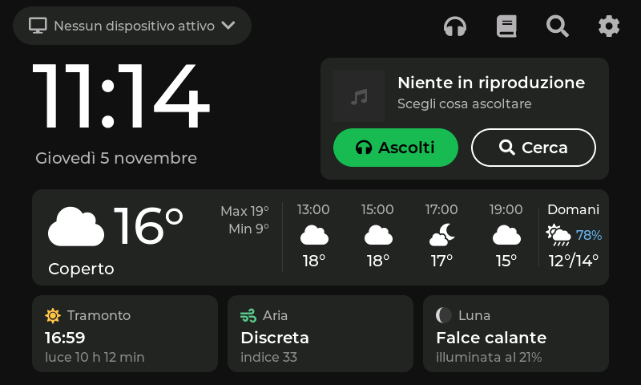
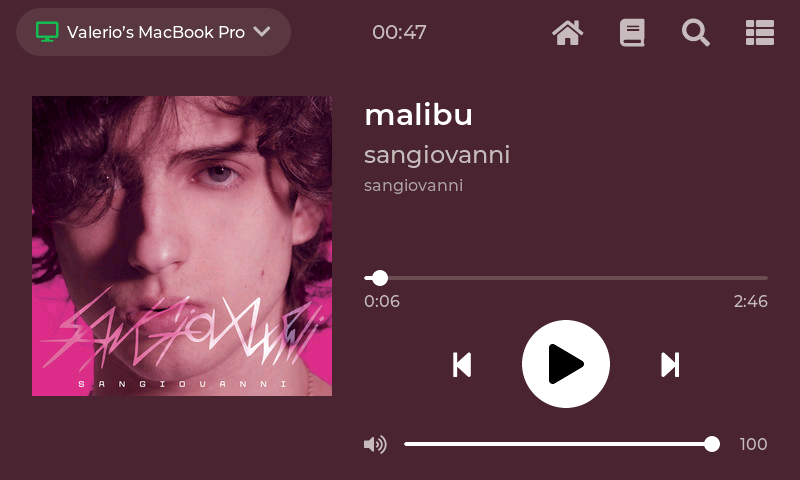
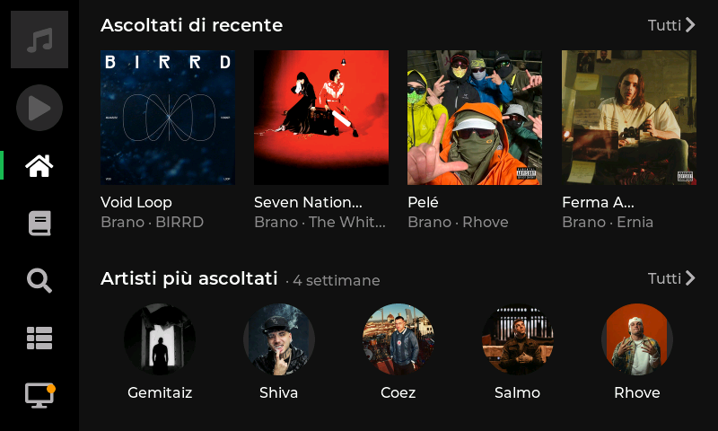
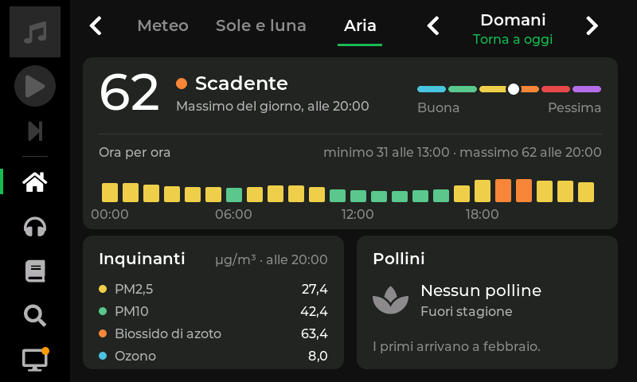

# ESP32 Spotify Controller

*[Leggi in italiano](README.it.md)*

A 5" touch screen that sits next to your computer and works as a **remote control and dashboard for Spotify**: what's playing, playback controls, your library, search, queue, devices. Its home screen also shows the time, the weather, sunrise and sunset, the moon and air quality.

The board never plays audio. Music keeps coming out of your computer, phone or speakers: the screen only sends commands through the [Spotify Web API](https://developer.spotify.com/documentation/web-api) (a **Premium** account is required).

| Home | Now playing |
|---|---|
|  |  |
| **Listening (Spotify home)** | **Air quality, any day** |
|  |  |

The interface is in Italian (the project was made in Italy). The screenshots are taken from the board itself.

## Features

- **Now playing**: cover, title, artist, progress, play/pause, previous/next, volume. The background follows the colours of the cover.
- **Library**: playlists, liked songs, albums, followed artists, with pages and track menus.
- **Search** (tracks, albums, artists, playlists), **queue** and **device picker**.
- **Listening** (Spotify home): recently played and your most played artists and tracks.
- **Home screen**, a dashboard of tiles: the time, a Spotify tile with ⏮ ⏯ ⏭ (Now playing opens when you tap it), and:
  - **weather** now and for the next hours, from [Open-Meteo](https://open-meteo.com/) (free, no key needed). The location comes from your internet connection, or you can set it;
  - **sun and moon**: sunrise, sunset, daylight, UV index, moon phase;
  - **air**: European air quality index, pollutants and pollen.
- **Computer status**: a small program on the Mac (`strumenti/ponte_computer.py`) sends battery, CPU, memory, disk and headphone battery over Wi-Fi every 5 seconds. A home tile shows the battery, or a warning (low battery, disk almost full, heat…); tapping it opens a page with everything.
- **Any day from 7 days ago to 7 days ahead** for weather, sun and moon, and air quality (air only up to 4 days ahead): arrows or a swipe.
- **Next track** and play/pause always at hand in the side bar of every page.
- **Settings**: Wi-Fi network and signal, firmware fingerprint and IP address.
- **Screen brightness**: 100%, then 15% after 2 minutes without touches (and back to the home screen), off after 12.
- **Wi-Fi setup from the phone**: on first boot the board creates its own network and a setup page.
- **Updates over Wi-Fi**, with automatic rollback if the new firmware crashes.

## Hardware

- **VIEWE UEDX80480050E-WB-A**: ESP32-S3 N16R8 (16 MB flash, 8 MB PSRAM), 5" RGB display 800×480 (ST7262), GT911 touch, microSD slot.
- A USB-C cable. The board has two ports: **UART** (upload and logs) and **USB** (native USB, not used yet).

Other ESP32-S3 boards with an 800×480 RGB display may work, but the display and touch settings in `firmware/` are written for this board.

## How it works

- **Core 0** runs the network: Wi-Fi, Spotify (state polled every 1.5 s, commands in a queue), cover downloads, weather.
- **Core 1** runs the interface with [LVGL 8](https://lvgl.io/).
- Large JSON responses and images live in the 8 MB PSRAM. Internal RAM is tight: only one TLS connection at a time (to `api.spotify.com`); covers and weather are fetched over plain HTTP.
- Secrets (Wi-Fi password, Spotify refresh token) are stored in the board's NVS and, on your computer, in `.env`. They are never in the code or in git.

The code comments and the notes are in Italian. `CLAUDE.md` collects every hardware and API detail found along the way, such as display glitches with Wi-Fi on, RAM limits and the Spotify API in 2026.

## Installation

### 1. Tools

- [arduino-cli](https://arduino.github.io/arduino-cli/) (or Arduino IDE 2.x)
- Python 3 and Git

On macOS: `brew install arduino-cli python git`. On Windows: `winget install ArduinoSA.CLI Python.Python.3.12 Git.Git`. On Apple Silicon, Arduino's `ctags` also needs Rosetta 2 (`softwareupdate --install-rosetta`).

### 2. ESP32 core and the "high performance" SDK

```bash
arduino-cli config init
arduino-cli config add board_manager.additional_urls https://espressif.github.io/arduino-esp32/package_esp32_index.json
arduino-cli core update-index
arduino-cli core install esp32:esp32@3.2.0
```

**Important:** with Wi-Fi on, the standard SDK makes the RGB display glitch: lines from higher up appear as flickering dashes. The fix is Espressif's "high_perf" build of the same SDK, which runs code from PSRAM:

1. Download [esp32-3.2.0-h.zip](https://dl.espressif.com/AE/esp-arduino-libs/esp32-3.2.0-h.zip).
2. Back up the folder `packages/esp32/tools/esp32-arduino-libs/idf-release_v5.4-2f7dcd86-v1/`, which is inside the Arduino data folder:
   - macOS: `~/Library/Arduino15`;
   - Linux: `~/.arduino15`;
   - Windows: `%LOCALAPPDATA%\Arduino15`.
3. Copy the contents of the zip over that folder.

Don't update the core afterwards without repeating this step. The code also builds on core 3.3.x with the standard SDK, but there the glitch comes back.

### 3. Libraries

```bash
arduino-cli lib install "ESP32_Display_Panel@1.0.4" "ESP32_IO_Expander@1.1.1" "esp-lib-utils@0.2.3" "lvgl@8.4.0" "ArduinoJson@7.4.3" "JPEGDEC@1.8.5"
```

Use LVGL **8**, not 9. `lv_conf.h` is already in `firmware/`, next to the sketch.

### 4. Build and upload

Connect the cable to the **UART** port and find the port with `arduino-cli board list`. Then:

```bash
FQBN="esp32:esp32:esp32s3:PSRAM=opi,FlashMode=qio,FlashSize=16M,PartitionScheme=app3M_fat9M_16MB,CDCOnBoot=default"
arduino-cli compile --fqbn "$FQBN" --build-path build firmware
arduino-cli upload  --fqbn "$FQBN" --input-dir build -p <port> firmware
```

### 5. Wi-Fi

On first boot the screen shows a network called `Controller-Spotify-XXXX` and its password:

1. Connect your phone to that network.
2. The setup page opens by itself; if it doesn't, open `http://192.168.4.1`.
3. Choose your home Wi-Fi and type its password.

To change network later, tap **Cambia Wi-Fi** on the clock.

### 6. Spotify

Because of the 2026 rules ([Development Mode](https://developer.spotify.com/documentation/web-api/tutorials/february-2026-migration-guide)), everybody needs their own Spotify app. The account that owns the app must be Premium, and up to 5 users can use it.

1. Go to [developer.spotify.com/dashboard](https://developer.spotify.com/dashboard) and create an app with **Web API**.
2. Set the redirect URI to exactly `http://127.0.0.1:8888/callback` (not `localhost`).
3. On your computer, with the board connected to the UART port:

```bash
python3 -m venv .venv
.venv/bin/pip install -r requirements.txt
.venv/bin/python strumenti/spotify_login.py
```

The script asks for the app's client ID and opens the browser for the login. It saves the client ID and the refresh token in `.env` and sends them to the board over the serial port. From then on, the board renews its access token by itself.

### 7. Updates over Wi-Fi (optional)

```bash
.venv/bin/python strumenti/aggiorna_wifi.py --prepara   # once, with the UART cable: creates the OTA password
.venv/bin/python strumenti/aggiorna_wifi.py             # every time: builds, finds the board on the network, uploads
```

If the new firmware restarts within its first 30 seconds on Wi-Fi, the board goes back to the previous version.

### 8. Computer status (optional, macOS)

```bash
python3 strumenti/ponte_computer.py
```

Run it on the Mac next to the screen, on the same Wi-Fi network. It uses only built-in macOS commands: nothing to install, no password. The board marks the computer as unreachable 30 seconds after the last packet.

## Testing from the computer

The board accepts commands on the serial port. `strumenti/comando.py` sends them and can also save screenshots:

```bash
.venv/bin/python strumenti/comando.py "TAP 400 380" "attesa 2" "foto shot.png"
```

Some commands:

| Command | What it does |
|---|---|
| `TAP x y`, `LONG x y`, `SWIPE x1 y1 x2 y2` | simulated touches |
| `METEO` | prints weather, sun, moon and air data |
| `METEO <lat> <lon> <city>` / `METEO AUTO` | fixed location / location from the internet connection |
| `METEO ARIA <index>`, `METEO POLLINI <type> <grains>`, `METEO LUNA <days>` | fake values for testing |
| `COMPUTER`, `COMPUTER PROVA <field> <value>` | prints the computer status / fake values for testing |
| `INATTIVO <s>` | pretends nobody has touched the screen for s seconds |

## How it was made

The project was built step by step with **Claude Code**, which wrote the firmware, and **Claude Design**, which designed the screens.

- `PIANO.md` is the plan, in phases.
- `design/` holds, for every feature:
  - the brief written for Claude Design (`BRIEF_*.md`);
  - the specification it delivered (`SPEC_*.md`) with its mockups;
  - the screenshots from the real board, to compare with the mockups.
- `CLAUDE.md` holds the instructions and lessons for the next sessions.

## Credits and licences

- Code: [MIT](LICENSE).
- [LVGL](https://github.com/lvgl/lvgl) (MIT), [ESP32_Display_Panel](https://github.com/esp-arduino-libs/ESP32_Display_Panel) (Apache 2.0), [ArduinoJson](https://arduinojson.org/) (MIT), [JPEGDEC](https://github.com/bitbank2/JPEGDEC) (Apache 2.0).
- Fonts converted with `lv_font_conv` and included in `firmware/font_*.c`:
  - [Montserrat](https://github.com/JulietaUla/Montserrat), SIL Open Font License 1.1;
  - [Font Awesome 5 Free](https://fontawesome.com/) icons, CC BY 4.0 (font files SIL OFL 1.1).
- Weather and air-quality data by [Open-Meteo.com](https://open-meteo.com/), CC BY 4.0. Location from [ip-api.com](https://ip-api.com/), free for non-commercial use.
- Not affiliated with Spotify. Spotify is a trademark of Spotify AB. Album covers in the screenshots belong to their owners.
