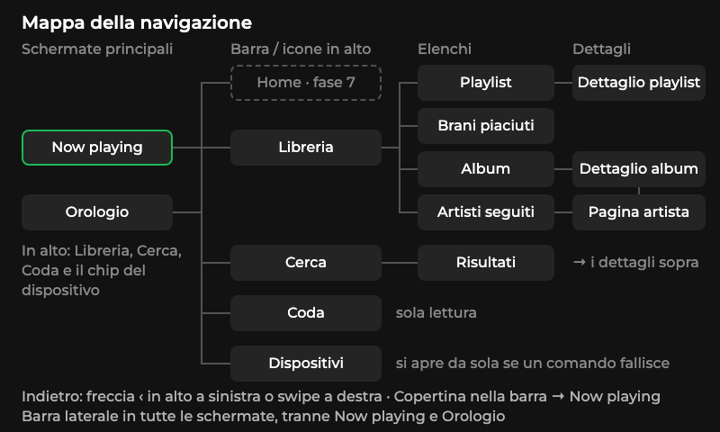

# Specifiche fase 6: navigazione

Documento di Claude Design per Claude Code. Risponde a `../BRIEF_FASE6.md`.

- **Mockup**: `mockup/NN_nome.png`, 800×480, numerati nell'ordine della mappa.
- **Sorgente dei mockup**: `canvas/project/*.dc.html` + `canvas/project/ui.css`. Il CSS usa esattamente le misure di questo documento: se una misura qui manca, vale quella del CSS.
- **Canvas online** (privato): https://claude.ai/artifact/2BmkheovXWkQTH5Pqxk8tw
- **Caratteri e icone**: `CARATTERI_E_ICONE.md`.

Convenzioni: coordinate in px dello schermo 800×480 con l'origine in alto a sinistra; `x,y` è l'angolo in alto a sinistra dell'oggetto; `L×A` = larghezza × altezza. Le copertine nei mockup sono quadrati colorati con un cerchio chiaro: rappresentano copertine già arrivate. Il quadrato grigio con l'icona è il segnaposto.

---

## 1. Mappa della navigazione

 — `01_mappa-navigazione.png`

```
Now playing ─┐  (icone in alto: Libreria · Cerca · Coda; chip del dispositivo)
Orologio ────┤
             ├─ [Home – fase 7, posto riservato]
             ├─ Libreria ─┬─ Playlist ──────── Dettaglio playlist (o "senza elenco")
             │            ├─ Brani piaciuti
             │            ├─ Album ─────────── Dettaglio album
             │            └─ Artisti seguiti ─ Pagina artista ── Dettaglio album
             ├─ Cerca ── Risultati ─────────── Dettaglio album / playlist / Pagina artista
             ├─ Coda (sola lettura)
             └─ Dispositivi  (si apre anche da sola se un comando fallisce)
```

Regole:

| Da | Gesto | Va a |
|---|---|---|
| Now playing / Orologio | icona Libreria, Cerca, Coda in alto a destra | la schermata corrispondente |
| Now playing / Orologio | chip del dispositivo in alto a sinistra | Dispositivi |
| Orologio | pulsanti "Libreria" / "Cerca" al centro | Libreria / Cerca |
| Qualsiasi schermata con la barra | copertina in cima alla barra | Now playing (Orologio se non suona niente) |
| Qualsiasi schermata con la barra | voce della barra | quella sezione, **sempre alla sua radice** (es. Libreria → griglia, non l'ultimo dettaglio) |
| Schermata di secondo livello (elenco, dettaglio, risultati) | freccia ‹ in alto a sinistra, oppure swipe verso destra sull'area contenuto | schermata precedente, **alla stessa pagina** in cui era |
| Qualsiasi elenco | swipe in su / in giù sull'elenco, oppure ▲ ▼ | pagina successiva / precedente |
| Qualsiasi comando che fallisce con "nessun dispositivo attivo" | automatico | Dispositivi in modalità "scegli dove suonare" (`13b`) |

- La **barra laterale** (88 px a sinistra) c'è in tutte le schermate della fase 6. Non c'è in Now playing, Orologio, Configura Wi‑Fi e Mi collego.
- Il cambio schermata è **istantaneo**, senza animazioni.
- Pila del "indietro": massimo 4 livelli (es. Libreria › Artisti › Artista › Album). Toccare una voce della barra azzera la pila.
- **Fase 7**: la Home avrà il posto vuoto nella barra a `y 152–216`, tra play/pausa e Libreria. Nella fase 6 quella fascia resta vuota e fa da separatore tra comandi e navigazione. Nella fase 7 non si sposta nient'altro.

---

## 2. Risposte alle domande aperte

**1. Libreria e now playing: schermate separate, divise o mini-player?**
Schermate separate, con un **mini-player ridotto all'osso dentro la barra laterale**: copertina 64 px (tocco = torna a Now playing) e un tasto play/pausa. Niente mini-player orizzontale in basso: a 480 px di altezza costerebbe una riga di lista intera, e il controllo più usato mentre si sfoglia è play/pausa. Now playing resta a tutto schermo, come oggi, perché è la "casa" del dispositivo.

**2. Liste o griglie per playlist e album?**
**Liste** nella fase 6. Le miniature a 64 px esistono già pronte da Spotify (niente riduzioni) e pesano poco da scaricare. Le liste funzionano bene anche prima che arrivino le immagini, perché il testo basta a riconoscere la voce, e mostrano nomi lunghi su una riga intera. Una griglia con riquadri da 150 px (300/2) mostra 6-8 copertine da 300 px per pagina: troppe da scaricare e decodificare una alla volta. Le griglie le teniamo per la Home della fase 7, dove sono poche e "di vetrina". Unica eccezione: la Libreria è una griglia 2×2 di 4 grandi riquadri, che non hanno immagini.

**3. Barra fissa o schermata hub?**
**Barra fissa a sinistra**, verticale. Lo schermo è orizzontale: lo spazio in larghezza abbonda, quello in altezza no. Una barra in basso ruberebbe 64-72 px di altezza a ogni elenco. La Libreria è comunque anche un piccolo hub, con 4 riquadri verso le quattro raccolte.

**4. Tastiera: QWERTY completa con accenti o ridotta?**
**QWERTY completa minuscola, con tasti da 64×54 px**: in 712 px ci stanno 10 colonne senza rimpicciolire nulla. Niente tasto maiuscole (la ricerca di Spotify ignora maiuscole e minuscole). Gli accenti si ottengono con la **pressione lunga sulle vocali** e non hanno una riga dedicata: la ricerca di Spotify trova "perché" anche scrivendo "perche", quindi servono di rado. C'è il tasto apostrofo, utile in italiano ("l'amore"). Il tasto "123" apre numeri e simboli.

**5. Dove va la scelta del dispositivo?**
In tre posti, sempre la stessa schermata:
1. il **chip in alto a sinistra** su Now playing e Orologio (icona + nome del dispositivo + ▾), che sostituisce la scritta "In riproduzione su…";
2. la **voce in fondo alla barra laterale**, con l'icona del tipo di dispositivo attivo (verde) o un pallino arancio se non ce n'è uno;
3. **in automatico** quando un comando fallisce perché non c'è un dispositivo attivo. Dopo la scelta, il comando che era fallito riparte da solo su quel dispositivo.

**6. Tocco su un brano: parte subito o menu?**
**Parte subito**, nel suo contesto: dentro una playlist o un album la riproduzione continua con i brani successivi. Si resta sulla schermata, così si può continuare a sfogliare. La **pressione lunga** apre un piccolo menu con "Aggiungi alla coda", "Vai all'album", "Vai all'artista" (`05b`). Il tocco è l'azione dell'uso quotidiano; il menu serve di rado e non deve rallentarla.

### Altre decisioni

- **Elenchi a pagine da 5 righe, niente scorrimento.** Il cambio pagina ridisegna l'area dell'elenco una volta sola, mentre lo scorrimento la ridisegnerebbe a ogni fotogramma. Si sfoglia con ▲ ▼ (colonna a destra) o con uno swipe verticale. Se in futuro volete provare lo scorrimento, misurate prima `05_playlist-dettaglio` (area 416×400): l'impaginazione resta identica.
- **Lettere non latine**: vedi §3.5.
- **Coda di sola lettura** nella fase 6: l'API non permette di saltare a un brano della coda senza chiamare "avanti" più volte.

---

## 3. Fondamenta

### 3.1 Colori (RGB565-friendly, tutti pieni)

| Nome | Hex | Uso |
|---|---|---|
| `BG` | `#121212` | fondo di tutte le schermate |
| `RAIL` | `#000000` | barra laterale, fondo della tastiera |
| `PANEL` | `#181818` | pannello sinistro dei dettagli |
| `SURFACE` | `#242424` | riquadri, chip, campo di ricerca, cerchi delle icone, scheletro (barra 1) |
| `SKELETON_2` | `#1E1E1E` | scheletro (barra 2) |
| `PRESSED` | `#2A2A2A` | riga premuta; tasto della tastiera normale; segnaposto copertina |
| `SURFACE_PRESSED` | `#333333` | riquadro della libreria premuto |
| `RAISED` | `#3A3A3A` | tasti funzione, cerchio della ×, binario degli slider, bordo del menu |
| `KEY_PRESSED` | `#5A5A5A` | tasto della tastiera premuto |
| `DISABLED_FG` | `#5A5A5A` | testo e icone disabilitati su fondo scuro |
| `DISABLED_FG_2` | `#3A3A3A` | icone disabilitate nella colonna pagine e in alto |
| `DISABLED_BG` | `#1A1A1A` | cerchio ▲▼ disabilitato |
| `PLACEHOLDER_FG` | `#535353` | icona dentro il segnaposto copertina; linee della mappa |
| `TEXT` | `#FFFFFF` | testo principale |
| `TEXT_2` | `#B3B3B3` | sottotitoli, icone normali |
| `TEXT_3` | `#8A8A8A` | durate, contatori, suggerimenti (contrasto 5,6:1 su `BG`) |
| `ACCENT` | `#1DB954` | play, brano in riproduzione, indicatore della barra, cursore |
| `ACCENT_PRESSED` | `#169C46` | pulsante verde premuto |
| `ON_ACCENT` | `#000000` | testo e icone sopra il verde |
| `WARN` | `#FF9800` | avvisi, pallino "nessun dispositivo" |
| `WARN_BG` | `#33240D` | fondo dell'avviso arancio |

Niente sfumature, trasparenze o ombre. Gli unici bordi sono pieni, da 1-2 px.

### 3.2 Caratteri

Famiglia **Montserrat** (SIL OFL 1.1). Dettagli e intervalli Unicode in `CARATTERI_E_ICONE.md`.

| Stile | Peso | px | Interlinea | Uso |
|---|---|---|---|---|
| `M16` | Medium 500 | 16 | 22 | sottotitoli, durate, contatori, suggerimenti |
| `M20` | Medium 500 | 20 | 26 | testo del campo di ricerca, chip, ora piccola, voci del menu, data e stato dell'orologio |
| `M24` | Medium 500 | 24 | 30 | artisti in Now playing, lettere della tastiera |
| `SB20` | SemiBold 600 | 20 | 26 | titoli delle righe, pulsanti, schede, nomi nel menu |
| `SB24` | SemiBold 600 | 24 | 30 | titolo dell'intestazione, nome nel pannello dettaglio, etichetta dei riquadri |
| `SB30` | SemiBold 600 | 30 | 38 | titolo del brano in Now playing |
| `CLOCK112` | Medium 500 | 112 | 120 | ora dell'orologio (solo cifre e ":") |

Rispetto a oggi: `M30` sparisce (diventa `SB30`); si aggiungono `SB20`, `SB24`, `SB30`. In tutto due caratteri in più.

### 3.3 Griglia e misure comuni

| Zona | x | y | L×A |
|---|---|---|---|
| Barra laterale | 0 | 0 | 88×480 |
| Area contenuto | 88 | 0 | 712×480 |
| Intestazione | 88 | 0 | 712×64 |
| Elenco (5 righe da 80) | 88 | 64 | 648×400 |
| Colonna pagine | 736 | 64 | 64×400 |
| Pannello dettaglio | 88 | 0 | 232×480 |
| Elenco nel dettaglio | 320 | 64 | 416×400 |

- Margine sinistro del contenuto: 24 px (testo a `x 112`), oppure 16 px dentro le righe.
- Bersagli di tocco: almeno **64×64**; le righe sono 648×80. Uniche eccezioni: i tasti della tastiera (64×54) e i chip (alti 48).
- Righe dell'elenco a `y` = 64, 144, 224, 304, 384.

### 3.4 Stati dei componenti (regola generale)

| Stato | Resa |
|---|---|
| Normale | come da tabella del componente |
| Premuto | cambia subito il colore di fondo (vedi componente); nessuna transizione (`transition` nulla) |
| Selezionato/attivo | testo/icona `TEXT` + segno `ACCENT` (barretta, sottolineatura o titolo verde) |
| Disabilitato | testo/icone `DISABLED_FG` (`#5A5A5A`), fondo invariato o `DISABLED_BG`; non risponde al tocco |
| In corso (dopo il tocco) | l'oggetto resta "premuto" e mostra uno spinner da 20 px al posto dell'elemento a destra (durata, freccia, icona) finché arriva la risposta |

Pressione lunga: 500 ms. Lo swipe usa la soglia gesti standard di LVGL.

### 3.5 Testo: troncamento, lettere non latine, formati

**Troncamento**: sempre con i puntini finali (`LV_LABEL_LONG_DOT`), niente testo che scorre.

| Testo | Righe max | Larghezza |
|---|---|---|
| Titolo riga elenco | 1 | fino al bordo destro della riga − 24 (− 96 se c'è la durata) |
| Sottotitolo riga | 1 | come il titolo |
| Titolo Now playing | 2 | 404 |
| Artisti / album Now playing | 1 | 404 |
| Nome nel pannello dettaglio | 2 | 184 |
| Dati sotto il nome (pannello) | 2 | 184 |
| Nome dispositivo nel chip | 1 | 260 |
| Testo della ricerca nel chip dei risultati | 1 | 136 |
| Etichette, schede, pulsanti | 1 | sono testi fissi: devono stare nello spazio |

**Lettere non supportate** (giapponese, coreano, cirillico…):
1. Prima di mostrare una stringa, togli i caratteri che il font non ha (vedi gli intervalli in `CARATTERI_E_ICONE.md`), poi comprimi gli spazi doppi e togli separatori rimasti soli all'inizio o alla fine (`-`, `·`, `(` `)` vuote).
2. Se resta almeno una lettera o una cifra, mostra quello che resta. Esempio: "米津玄師 - Lemon" diventa "Lemon".
3. Se non resta niente, mostra un testo di riserva in `TEXT_3`: **"Titolo non latino"** (brani, album), **"Nome non latino"** (artisti, playlist, dispositivi). Esempio in `09_artisti-elenco.png`.
4. Mai mostrare quadratini.

**Formati**: durata brano `m:ss` (da un'ora in su `h:mm:ss`); durata totale album `41 min` / `1 h 12 min`; artisti separati da ", "; separatore tra dati " · " (punto mediano U+00B7, che è nel font); anno a 4 cifre.

### 3.6 Immagini

- Box usati: **64×64** (righe, barra), **150×150** (pannello dettaglio), **300×300** (Now playing).
- Scelta della sorgente: tra le misure date da Spotify e le riduzioni 1, 1/2, 1/4, 1/8, prendi quella **più vicina al box e non più piccola di box − 8 px**. Centrala nel box e ritaglia quello che avanza; mai ridimensionare in modo arbitrario.
  - Album: 64 → 64; 300/2 → 150; 300 → 300.
  - Artisti (Spotify dà 640/320/160): 160/2 = 80 ritagliato a 64; 160 ritagliato a 150.
  - Playlist a mosaico da 60: centrata nel box da 64, con 2 px di `PRESSED` intorno.
- Finché l'immagine non arriva: **segnaposto** = quadrato `PRESSED #2A2A2A` con un'icona `PLACEHOLDER_FG #535353` al centro: nota (playlist e brani), disco (album), persona (artisti). Icona da 20 nel box da 64, da 40 nel box da 150.
- Copertine **quadrate, senza angoli arrotondati**: niente maschere.
- Artisti **tondi** (raggio pieno con `clip_corner`), solo nei box da 64 e da 150. Se la maschera rallenta lo schermo con il Wi‑Fi attivo, usate il quadrato: è l'unica differenza.
- Ordine di scaricamento: solo le immagini della pagina visibile, dall'alto in basso. Cambiando pagina, annulla quelle in attesa. Le miniature restano in una cache in PSRAM (es. ultime 60 × 8 KB).

### 3.7 Rete, caricamenti, pagine

- **Una pagina = 5 righe.** Si chiedono 50 voci per richiesta, cioè 10 pagine. Andando su una pagina non ancora caricata, l'elenco mostra le righe scheletro (`04b`) e parte la richiesta successiva (`offset`).
- Contatore della colonna pagine: `p/N`, con N = ⌈total/5⌉ (Spotify restituisce `total`). Nella ricerca, quando ci sono altri risultati da chiedere, il contatore mostra `p/N+` (es. `1/2+`).
- Ultima pagina con meno di 5 righe: sotto l'ultima riga, a 24 px, il testo centrato `M16 TEXT_3` **"Fine dell'elenco · 27 artisti"** (`09_artisti-elenco.png`).
- Torna indietro: l'elenco precedente resta in memoria e ricompare **subito, alla stessa pagina**, senza nuova richiesta (cache valida 5 minuti).
- Errore su una pagina successiva alla prima: la pagina mostra il blocco errore (`04c`) nell'area dell'elenco; la colonna pagine resta attiva per tornare indietro.
- Spinner nell'intestazione (28 px a `x 692, y 18`) durante qualunque caricamento della schermata.

---

## 4. Componenti riutilizzabili

### 4.1 Barra laterale (`rail`) — 88×480, fondo `RAIL #000000`

| Elemento | Area di tocco | Contenuto | Stati |
|---|---|---|---|
| Copertina | 0,0 88×88 | copertina 64×64 a `12,12` (box 64 del brano attuale) | premuto: fondo dell'area `#1F1F1F`; niente in riproduzione: segnaposto con nota 28 |
| Play/pausa | cerchio 52 a `18,94` (tocco 0,88 88×64) | cerchio `TEXT #FFFFFF`, icona play/pausa 28 `#000000` | premuto: cerchio `#B3B3B3`; disabilitato (niente da suonare): cerchio `#2A2A2A`, icona `#5A5A5A` |
| (riservato fase 7) | 0,152 88×64 | vuoto | — |
| Libreria | 0,216 88×64 | icona 28 centrata | normale `TEXT_2`; attivo `TEXT` + barretta `ACCENT` 4×32 a `x 0`, centrata in verticale; premuto: fondo `#1F1F1F` |
| Cerca | 0,280 88×64 | icona 28 | come sopra |
| Coda | 0,344 88×64 | icona 28 | come sopra |
| Dispositivi | 0,408 88×72 | icona 28 del tipo di dispositivo attivo | icona `ACCENT` se c'è un dispositivo attivo; altrimenti icona "computer" `TEXT_2` + pallino `WARN` 10×10 a `52,428`; attivo/premuto come sopra (barretta a `y 428`) |

La voce "attiva" è la sezione in cui ci si trova, anche dentro i suoi dettagli: Playlist, Album e Artisti accendono Libreria; Risultati accende Cerca.
Consiglio d'implementazione: create la barra una volta sola e cambiate solo il contenitore dell'area contenuto (712×480), così la barra non si ridisegna a ogni navigazione. Copertina e play/pausa si aggiornano solo quando cambiano (stessa logica di `ui_set_text()`).

### 4.2 Intestazione — 712×64 a `88,0`

| Elemento | Posizione | Stile |
|---|---|---|
| Freccia indietro (solo secondo livello) | tocco 64×64 a `88,0`; icona 28 `TEXT` | premuto: cerchio 48 `PRESSED` dietro l'icona |
| Titolo | `x 112` (senza freccia) o `x 156` (con freccia), `y 17` | `SB24 TEXT`, 1 riga, max fino a `x 540` |
| Contatore / info | allineato a destra su `x 720`, `y 21` | `M16 TEXT_3` (es. "32 playlist") |
| Azione a destra (facoltativa) | pulsante `bp sm` 144×48 a `576,8` oppure icona 64×64 a `672,0` | vedi 4.7 |
| Spinner caricamento | 28×28 a `692,18` | prende il posto del contatore |

### 4.3 Riga di elenco — 648×80 a `x 88`

| Elemento | Posizione relativa alla riga | Stile |
|---|---|---|
| Area di tocco | intera riga | normale trasparente; premuto `PRESSED #2A2A2A` |
| Immagine | `16,8` 64×64 | vedi 3.6 (tonda per gli artisti) |
| Cerchio icona (solo dispositivi) | `16,12` 56×56, fondo `SURFACE` | icona 28 `TEXT_2`; attivo: fondo `ACCENT`, icona `#000000`; in corso: fondo `RAISED` |
| Titolo | `96,15`, fino a −24 dal bordo destro (−96 con durata) | `SB20 TEXT`, 1 riga |
| Sottotitolo | `96,43` | `M16 TEXT_2`, 1 riga |
| Durata / elemento a destra | allineato a destra a −16, `y 29`, larghezza 64 | `M16 TEXT_3`; oppure icona 20 |

Varianti e contenuti:

| Variante | Titolo | Sottotitolo | A destra | Tocco | Pressione lunga |
|---|---|---|---|---|---|
| Playlist | nome | proprietario · [collaborativa ·] N brani | — | apre il dettaglio | — |
| Album | nome | artisti · anno | — | apre il dettaglio | — |
| Artista | nome | primi 2 generi, oppure "Artista" | — | apre la pagina artista | — |
| Brano | titolo | artisti (nei risultati: artisti · album) | durata | avvia il brano nel contesto | menu del brano |
| Dispositivo | nome | tipo [· volume N%] | ✓ verde se attivo | sposta la musica lì | — |
| Coda | titolo | artisti | durata | nessuno (sola lettura, nessuno stato premuto) | — |

**Brano in riproduzione** (confrontando l'URI con `/me/player`): titolo `ACCENT`, durata sostituita da icona volume 20 `ACCENT`; nelle righe numerate (dettaglio) l'icona prende il posto del numero.
**Riga disabilitata** (dispositivo `is_restricted`): titolo, sottotitolo e icona `#5A5A5A`, nessuno stato premuto.

### 4.4 Riga del dettaglio — 416×80 a `x 320`

Come 4.3, ma con il numero al posto dell'immagine:
- Numero: `0,29`, larghezza 48, centrato, `M16 TEXT_3`.
- Titolo `48,15`, sottotitolo `48,43`, fino a −88 dal bordo destro.
- Durata a destra come 4.3.
- Variante con copertina (pagina artista): immagine `16,8` 64×64, testo da `x 96`, fino a −16.

### 4.5 Colonna pagine — 64×400 a `736,64`

| Elemento | Posizione | Stile |
|---|---|---|
| ▲ | tocco 64×80 a `736,64`; cerchio 48 centrato, fondo `SURFACE #242424`, chevron 28 `TEXT` | premuto: cerchio `RAISED`; disabilitato (prima pagina): cerchio `#1A1A1A`, chevron `#3A3A3A` |
| Contatore | centrato a `x 768`, `y 253` | `M16 TEXT_3`, es. "2/18" |
| ▼ | tocco 64×80 a `736,384` | come ▲; disabilitato all'ultima pagina |

Si nasconde del tutto se l'elenco ha al massimo 5 voci.

### 4.6 Pannello dettaglio — 232×480 a `88,0`, fondo `PANEL #181818`

| Elemento | Posizione | Stile |
|---|---|---|
| Freccia indietro | 64×64 a `88,0` | 4.2 |
| Contesto | `152,21`, L 160 | `M16 TEXT_2` ("Playlist", "Album", "Artista") |
| Immagine | `112,72` 150×150 | 3.6 (tonda per l'artista) |
| Nome | `112,234`, L 184 | `SB24 TEXT`, 2 righe |
| Dati | subito sotto il nome (+6 px) | `M16 TEXT_2`, 2 righe |
| Riproduci | `112,400` 184×56 | pulsante primario 4.7 con icona play 20 |

Nome e dati stanno in una colonna flex che parte a `y 234`: se il nome occupa una riga sola, i dati salgono.

### 4.7 Pulsanti

| Tipo | Misure | Normale | Premuto | Disabilitato |
|---|---|---|---|---|
| Primario `bp` | alto 56, raggio 28 | fondo `ACCENT`, testo `SB20 #000000`, icona 20 `#000000`, spazio icona-testo 8 | fondo `ACCENT_PRESSED` | fondo `#2A2A2A`, testo/icona `#5A5A5A` |
| Secondario `bs` | alto 56, raggio 28, bordo 2 `TEXT` | fondo trasparente, testo `SB20 TEXT` | fondo `PRESSED` | bordo e testo `#5A5A5A` |
| Piccolo (`sm`) | alto 48, raggio 24 | come sopra | come sopra | come sopra |
| Icona `ibtn` | tocco 64×64, icona 28 | icona `TEXT_2` (in alto) o `TEXT` (trasporto) | cerchio 48 `PRESSED` dietro l'icona | icona `#3A3A3A` |
| In corso | — | l'icona del pulsante diventa uno spinner 20 nello stesso colore | — | — |

### 4.8 Scheletro di caricamento (`04b`)

Per ogni riga: quadrato 64×64 `SURFACE` a `16,8`, barra 1 alta 16 a `96,20` (larghezze alternate 240/300/200/260/220) `SURFACE` raggio 8, barra 2 alta 12 a `96,48` (160/120/150/180/140) `SKELETON_2` raggio 8. **Statico**, senza luccichio. Colonna pagine nascosta. Lo spinner dell'intestazione è l'unico elemento animato.

### 4.9 Blocco stato (vuoto / errore)

Centrato nell'area libera (contenuto 88–800, oppure 320–800 nei dettagli):

| Elemento | y | Stile |
|---|---|---|
| Cerchio icona | 112 (120 se non c'è il pulsante) | 80×80 `SURFACE`, icona 40: `TEXT_2` (vuoto) o `WARN` (errore) |
| Titolo | 216 (224) | `SB20 TEXT`, centrato, max 2 righe |
| Testo | 250 (258) | `M16 TEXT_2`, centrato, max 2 righe |
| Pulsante (facoltativo) | 296 | secondario 176×56 (o più largo per testi lunghi), centrato |

Testi usati:

| Caso | Titolo | Testo | Pulsante |
|---|---|---|---|
| Errore di rete (qualsiasi elenco) | "Non riesco a caricare le playlist" (… gli album / i brani / gli artisti / la coda / i dispositivi) | "Controlla il Wi‑Fi e riprova." | Riprova |
| Playlist vuota | "Questa playlist è vuota" | "Aggiungi i brani dall'app Spotify: compariranno qui." | — |
| Brani piaciuti vuoto | "Nessun brano piaciuto" | "Tocca il cuore su un brano nell'app Spotify e lo ritroverai qui." | — |
| Album / artisti / playlist: nessuno | "Nessun album salvato" / "Nessun artista seguito" / "Nessuna playlist" | "Salvali dall'app Spotify: compariranno qui." | — |
| Coda vuota | "La coda è vuota" | "Avvia una playlist o un album: i prossimi brani compariranno qui." | Apri la libreria |
| Ricerca senza risultati | "Nessun risultato per «testo»" | "Controlla come l'hai scritto o prova con meno parole." | Modifica la ricerca |
| Nessun dispositivo | "Nessun dispositivo trovato" | "Apri Spotify sul computer o sul telefono, poi tocca Riprova." | Riprova |
| Playlist non tua | "Spotify non mostra i brani di questa playlist" | "È una playlist di Spotify o di un altro utente. Puoi comunque avviarla con Riproduci." | — (c'è Riproduci nel pannello) |

### 4.10 Schede (tab) — 104×64 ciascuna

- Testo `SB20`, centrato. Normale `TEXT_3`; selezionata `TEXT` + sottolineatura `ACCENT` 56×3 centrata a `y 55`; premuta: testo `TEXT`.
- Risultati: Brani `320`, Album `424`, Artisti `528`, Playlist `632` (y 0).
- Pagina artista: Album `336`, Singoli `440`, Altro `544` (y 0). "Altro" = compilation + "appare in".

### 4.11 Menu del brano (`05b`)

- Pannello 320×235, fondo `#2A2A2A`, bordo 1 `RAISED`, raggio 12, **opaco, senza ombra né oscuramento dello sfondo**.
- Posizione: `x 400`. Se la riga premuta è nella metà alta dell'elenco (riga 1-2), il menu va sotto la riga (y = fondo riga + 8); altrimenti sopra (y = cima riga − 8 − 235). La riga premuta resta `PRESSED` finché il menu è aperto.
- Testata alta 64: titolo `SB20` a `20,10`, artista `M16 TEXT_2` a `20,36`, poi un separatore 1 px `RAISED`.
- 3 voci 320×56: icona 20 `TEXT_2` a `x 20`, testo `M20 TEXT` a `x 56`; premuta: fondo `RAISED`.
  - "Aggiungi alla coda" (icona +): `POST /me/player/queue`, poi chiude il menu e mostra il toast "Aggiunto alla coda".
  - "Vai all'album" (disco): apre il dettaglio album.
  - "Vai all'artista" (persona): apre la pagina del primo artista.
- Si chiude toccando fuori, con "indietro" o dopo una scelta.

### 4.12 Toast (solo specifica, nessun mockup)

- Alto 48, raggio 24, larghezza = testo + 48 (max 600), centrato sull'area contenuto (`x` centro 444), `y 408`.
- Informazione: fondo `#FFFFFF`, testo `M16 #121212`. Errore: fondo `WARN_BG`, bordo 1 `WARN`, icona avviso 20 `WARN` + testo `M16 TEXT`.
- Compare e sparisce di colpo dopo 2,5 s, senza dissolvenza. Un tocco lo chiude.
- Testi: "Aggiunto alla coda", "In riproduzione su «nome»", errore generico "Non è partito. Riprova.".

### 4.13 Avviso arancio (`13b`)

`104,68` 680×56, fondo `WARN_BG #33240D`, bordo 1 `WARN`, raggio 12; icona avviso 20 `WARN` a +16, testo `M16 TEXT` a +48, 1 riga.

### 4.14 Spinner

Anello da 28 (spessore 4) o 20 (spessore 3): fondo anello `PRESSED #2A2A2A`, arco 90° `ACCENT` (sopra il verde: arco `#000000`, anello `#0E5C2A`). Un giro al secondo. È `lv_spinner` con queste misure.

### 4.15 Chip

Alto 48, raggio 24, padding orizzontale 20, fondo `SURFACE`, spazio interno 8. Premuto `RAISED`.
- Chip dispositivo (Now playing, Orologio): `16,8`. Icona tipo 20 (`ACCENT` se attivo, `TEXT_2` se no), nome `M16` (`TEXT` se attivo, `TEXT_2` se "Nessun dispositivo attivo"), chevron giù 20 `TEXT_2`.
- Chip ricerche recenti: testo `M20 TEXT`, in fila a `112,122`, spazio 12, quanti ne stanno (max 4).
- Chip della ricerca nei risultati: `104,8`, L 200, icona lente 20 `TEXT_2` + testo `M20`.

### 4.16 Slider (Now playing)

Binario alto 4, raggio 2, `RAISED`; parte piena `TEXT`; pomello 16×16 `TEXT`. Area di tocco alta 48, centrata sul binario. Durante il trascinamento: parte piena e pomello restano bianchi (nessun ingrandimento).

### 4.17 Riquadro della libreria — 324×184, raggio 12

Fondo `SURFACE`, premuto `SURFACE_PRESSED`. Icona 28 a `24,24` (`TEXT`; cuore `ACCENT`), etichetta `SB24` a `24,116`, conteggio `M16 TEXT_2` a `24,148`.

### 4.18 Tastiera (`12`)

Fondo `RAIL` a `88,208` 712×272. Tasti raggio 8, testo `M24 TEXT`.

| Riga | y | x di partenza | Tasti (L×A 64×54, spazio 6) |
|---|---|---|---|
| 1 | 224 | 97 | q w e r t y u i o p |
| 2 | 286 | 97 | a s d f g h j k l ' |
| 3 | 348 | 132 | z x c v b n m, poi ⌫ largo 169 (tasto funzione) |
| 4 | 410 | 97 | "123" largo 134 (funzione, `M20`), "spazio" largo 344 (testo `M16 TEXT_2`), "Cerca" largo 204 (verde) |

| Tasto | Normale | Premuto | Disabilitato |
|---|---|---|---|
| Lettera | `#2A2A2A` | `#5A5A5A` | — |
| Funzione (⌫, 123) | `#3A3A3A` | `#5A5A5A` | — |
| Cerca | `ACCENT`, `SB20 #000000` | `ACCENT_PRESSED` | campo vuoto: `#2A2A2A`, testo `#5A5A5A` |

- Si scrive in minuscolo. ⌫ tenuto premuto ripete ogni 100 ms dopo 500 ms.
- **Accenti**: pressione lunga (500 ms) su a, e, i, o, u apre sopra il tasto un riquadro opaco `RAISED` raggio 12, padding 6, con i tasti 64×54: a → à · e → è é · i → ì · o → ò · u → ù. Si sceglie trascinando il dito o con un tocco; un tocco fuori chiude. Il riquadro sta a `y` = tasto − 66, allineato al tasto e spostato per restare dentro `88–800`.
- **"123"**: righe 1 2 3 4 5 6 7 8 9 0 · - / : ; ( ) & @ " # · . , ? ! + * % ⌫ · "abc" / spazio / Cerca.
- Massimo 64 caratteri.

---

## 5. Schermate

### 5.1 Now playing (rivista) — `02_now-playing.png`

Cambia rispetto a oggi: la barra in alto ha chip e icone, il titolo è SemiBold, l'ora è al centro e le posizioni sono riallineate.

| Elemento | x,y | L×A | Stile |
|---|---|---|---|
| Chip dispositivo | 16,8 | auto×48 (max 360) | 4.15 → Dispositivi |
| Ora | centrata, y 19 | L 100 | `M20 TEXT_2` |
| Libreria / Cerca / Coda | 600,0 · 664,0 · 728,0 | 64×64 | `ibtn`, icone 28 `TEXT_2` |
| Copertina | 32,96 | 300×300 | quadrata |
| Titolo | 364,96 | L 404 | `SB30`, 2 righe |
| Artisti | sotto il titolo +6 | L 404 | `M24 TEXT_2`, 1 riga |
| Album | sotto gli artisti +4 | L 404 | `M16 TEXT_3`, 1 riga |
| Barra avanzamento | 364,276 | 404×4 (tocco 404×48 a y 252) | 4.16 |
| Tempo trascorso / totale | 364,290 · destra a 768 | — | `M16 TEXT_2` |
| Indietro | 430,332 | 64×64 | icona 28 `TEXT`; premuto: cerchio 56 `PRESSED` |
| Play/pausa | 522,320 | cerchio 88 | `ACCENT`, icona 40 `#000000`; premuto `ACCENT_PRESSED` |
| Avanti | 638,332 | 64×64 | come Indietro |
| Icona volume | 364,434 | 20 | `TEXT_2` |
| Slider volume | 404,442 | 308×4 (tocco alto 48) | 4.16 |
| Valore volume | destra a 768, y 433 | L 48 | `M16 TEXT_2` |

Se il dispositivo non permette il volume (`supports_volume` falso), lo slider è disabilitato: binario `#2A2A2A`, niente pomello, valore "—".

### 5.2 Orologio (rivisto) — `02b_orologio.png`

| Elemento | x,y | Stile |
|---|---|---|
| Chip dispositivo | 16,8 | "Nessun dispositivo attivo" `TEXT_2`, icona computer `TEXT_2`; se c'è un dispositivo ma è fermo, il suo nome in `TEXT` |
| Libreria / Cerca / Coda | come Now playing | Coda disabilitata (`#3A3A3A`) |
| Ora | centrata, y 96 | `CLOCK112`, interlinea 120 |
| Data | centrata, y 228 | `M20 TEXT_2` ("Lunedì 2 novembre") |
| Stato | centrato, y 276 | `M20 TEXT` |
| Suggerimento | centrato, y 308 | `M16 TEXT_3` |
| Libreria / Cerca | 216,348 · 408,348 | `bp sm` e `bs sm` 176×48 con icona 20 |
| Wi‑Fi | icona 24,437; testo 52,436 | `M16 TEXT_3` |
| Cambia Wi‑Fi | 600,420 | `bs sm` 176×48, bordo `#535353` |

### 5.3 Libreria — `03_libreria.png`

Titolo "Libreria" (senza freccia). Quattro riquadri 4.17: Playlist `112,80`, Brani piaciuti `452,80`, Album `112,280`, Artisti seguiti `452,280`. Il riquadro premuto è disegnato in `03` (Artisti).
Conteggi: si mostra il `total` salvato dall'ultima apertura di quell'elenco. Finché non c'è, la riga resta vuota: niente 4 richieste solo per i numeri.

### 5.4 Playlist — elenco, caricamento, errore — `04_playlist-elenco.png`, `04b_playlist-caricamento.png`, `04c_playlist-errore.png`

- Intestazione: freccia, "Playlist", contatore "N playlist".
- Righe variante Playlist (4.3). In `04` si vedono copertine arrivate e segnaposto, oltre al troncamento di un nome lungo.
- Dati: `GET /me/playlists?limit=50&offset=…`.
- `04b`: scheletro (4.8) + spinner. `04c`: blocco errore con Riprova, che ripete la stessa richiesta.

### 5.5 Dettaglio playlist — `05_playlist-dettaglio.png`, `05b_menu-brano.png`, `05c_playlist-senza-elenco.png`, `05d_playlist-vuota.png`

- Pannello 4.6: contesto "Playlist", nome, "proprietario · N brani". Nessuna durata totale: con più di 50 brani non è nota finché non si sono caricati tutti.
- Info in alto a destra: `M16 TEXT_3` a `344,21`, "Brani 6–10 di 87".
- Righe 4.4 numerate (posizione nella playlist).
- **Riproduci**: `PUT /me/player/play` con `context_uri` della playlist.
- **Tocco su un brano**: stesso contesto + `offset.uri` del brano.
- Si decide se mostrare l'elenco **senza nuove richieste**: si mostra se `owner.id` == id dell'utente (`GET /me` all'avvio) oppure `collaborative`. Altrimenti → layout `05c`: pannello uguale con Riproduci attivo, a destra il blocco stato "Playlist non tua".
- `05d`: playlist propria con 0 brani. Copertina segnaposto 150 con nota 40, Riproduci disabilitato, blocco "vuota".
- Dati: `GET /playlists/{id}/items?limit=50&offset=…`. Nome, immagine e proprietario arrivano già dall'elenco.

### 5.6 Brani piaciuti — `06_brani-piaciuti.png`, `06b_brani-piaciuti-vuoto.png`

- Intestazione: freccia, "Brani piaciuti", "N brani" (`M16 TEXT_3` a `368,21`), pulsante `bp sm` "Riproduci" 144×48 a `576,8`.
- Righe variante Brano con copertina e durata.
- Riproduci / tocco: `context_uri` = `spotify:user:{id}:collection` (+ `offset.uri` per il tocco). **Da verificare** con l'API 2026. Se viene rifiutato: `uris` = i brani caricati a partire da quello toccato (max 50).
- Dati: `GET /me/tracks?limit=50&offset=…`.

### 5.7 Album — `07_album-elenco.png`, `08_album-dettaglio.png`

- `07`: righe variante Album; la riga premuta è disegnata.
- `08`: pannello con contesto "Album", nome, "artista · anno · N brani"; info a destra "N brani · M min" (durata totale = somma dei brani, nota perché un album ha di solito meno di 50 brani; se ne ha di più, solo "N brani"). Righe numerate con il numero di traccia. In `08` il brano 2 è appena stato toccato: riga premuta + spinner al posto della durata.
- Dati: gli oggetti di `GET /me/albums` contengono già i primi 50 brani, quindi aprendo da "Album" non serve una richiesta in più. Aprendo da ricerca, artista o menu: `GET /albums/{id}` (oppure `/albums/{id}/tracks`).
- Riproduci / tocco: come la playlist, con `context_uri` dell'album.

### 5.8 Artisti — `09_artisti-elenco.png`, `10_artista-pagina.png`

- `09` mostra **l'ultima pagina** (6/6): 2 righe, "Fine dell'elenco · 27 artisti", ▼ disabilitato, e il caso **nome non latino**.
- `10`: pannello con foto tonda 150, nome, generi (max 2 righe); Riproduci = `context_uri` dell'artista. A destra le schede Album / Singoli / Altro (4.10) e righe con copertina (4.4, variante con copertina): titolo = nome, sottotitolo = anno. Tocco → dettaglio album.
- Dati: `GET /me/following?type=artist&limit=50&after=…` (paginazione a cursore: tenete i cursori delle pagine già viste). Pagina artista: `GET /artists/{id}/albums?include_groups=album` (poi `single`, poi `compilation,appears_on`), una richiesta per scheda, al primo tocco sulla scheda.

### 5.9 Coda — `11_coda.png`, `11b_coda-vuota.png`

- Titolo "Coda" senza freccia (è una sezione della barra), info "N in coda".
- Riga 1 = brano attuale: titolo `ACCENT`, sottotitolo che inizia con "In riproduzione" in `ACCENT`, icona volume. Separatore 1 px `PRESSED` da `x 104` a `x 720` sotto la riga 1. Poi i prossimi brani.
- Sola lettura: nessuno stato premuto.
- Dati: `GET /me/player/queue` all'apertura e a ogni cambio di brano mentre la schermata è aperta.
- `11b`: niente in riproduzione. Barra con segnaposto, play disabilitato, pallino arancio sui dispositivi; blocco "La coda è vuota" + "Apri la libreria".

### 5.10 Ricerca — `12_ricerca-tastiera.png`, `12b_ricerca-risultati.png`, `12c_ricerca-nessun-risultato.png`

**`12` Tastiera**
| Elemento | x,y | L×A | Stile |
|---|---|---|---|
| Campo | 104,12 | 680×56, raggio 28 | `SURFACE`; lente 20 `TEXT_2` a +20; testo `M20 TEXT` a +52; cursore 2×26 `ACCENT` lampeggiante |
| Segnaposto (campo vuoto) | — | — | "Cerca brani, album, artisti" `M20 TEXT_3` |
| Cancella | tocco 56×56 a 724,12 | cerchio 32 `RAISED`, × 20 `TEXT` | visibile solo se c'è testo |
| "Ricerche recenti" | 112,92 | — | `M16 TEXT_3` |
| Chip recenti | 112,122 | alti 48 | 4.15; tocco = cerca subito |
| Tastiera | 88,208 | 712×272 | 4.18 |

Ricerche recenti: le ultime 4 diverse, salvate in NVS. Se non ce ne sono, al loro posto: "Scrivi il nome di un brano, un album, un artista o una playlist." `M16 TEXT_3`.

**`12b` Risultati**
- Intestazione: chip della ricerca (tocco = torna alla tastiera con il testo) + schede Brani / Album / Artisti / Playlist.
- **Una sola richiesta** per tutte le schede: `GET /search?q=…&type=track,album,artist,playlist&limit=10`. Pagine da 5 → 2 pagine per scheda. ▼ sull'ultima pagina caricata chiede altri 10 di quella scheda (`offset`); contatore `p/N+`.
- Scheda iniziale: Brani; se non ha risultati, la prima che ne ha. Una scheda vuota mostra al centro "Nessun brano" (album, artista, playlist) in `M16 TEXT_3`.
- Tocco su un brano: `context_uri` = album del brano + `offset.uri` (così continua con l'album). Album, artista e playlist aprono i rispettivi dettagli.
- Toccare "Cerca" nella barra mentre si è nei risultati riporta alla tastiera, con il testo.

**`12c`**: tutte le schede vuote → blocco stato, con "Modifica la ricerca" che torna alla tastiera.

### 5.11 Dispositivi — `13_dispositivi.png`, `13b_dispositivi-nessuno-attivo.png`, `13c_dispositivi-vuoto.png`

- Titolo "Dispositivi", icona Aggiorna 64×64 a `672,0`. Righe variante Dispositivo (4.3); il dispositivo attivo sta in cima.
- Tocco su un dispositivo non attivo: `PUT /me/player` con `device_ids:[id]` e `play:true`. La riga passa allo stato "in corso" (cerchio `RAISED`, sottotitolo "Sposto la musica qui…", spinner 20). A conferma, la riga diventa attiva e compare il toast "In riproduzione su «nome»". In caso di errore: toast di errore, e la riga torna normale.
- Dispositivi `is_restricted`: riga disabilitata, sottotitolo "TV · non controllabile da qui".
- Sotto l'ultima riga (se c'è spazio): "Non vedi un dispositivo? Apri Spotify lì e aggiorna l'elenco." `M16 TEXT_3` a `112,412`.
- **`13b` aperta da un comando fallito** (risposta 404 `NO_ACTIVE_DEVICE`):
  - Il comando (es. "Riproduci Rap italiano 2000s") resta in sospeso. Compare la freccia indietro, che annulla e torna alla schermata di prima.
  - Avviso arancio 4.13: "Nessun dispositivo attivo: scegli dove far partire la musica."; righe da `y 136` (max 4 per pagina).
  - In basso: "Appena scegli, parte «nome del contesto» su quel dispositivo."
  - Tocco su un dispositivo: **una sola richiesta**, `PUT /me/player/play?device_id=…` con il corpo del comando sospeso. Poi si torna alla schermata di prima, con il toast "In riproduzione su «nome»".
- `13c`: nessun dispositivo nella risposta → blocco stato con Riprova.
- Dati: `GET /me/player/devices` all'apertura e con Aggiorna.

Icona per tipo (`type` di Spotify):

| type | Icona |
|---|---|
| Computer | computer (desktop) |
| Smartphone | telefono |
| Tablet | tablet |
| Speaker, AVR, AudioDongle, CastAudio | volume (cassa) |
| TV, CastVideo, STB | TV |
| GameConsole | gamepad |
| Automobile | auto |
| altro / Unknown | nota musicale |

---

## 6. Animazioni (tutte)

| Cosa | Durata | Area |
|---|---|---|
| Spinner | 1 giro/s, continuo | 28×28 o 20×20 |
| Cursore del campo di ricerca | 500 ms acceso / 500 ms spento | 2×26 |
| Barra di avanzamento (già esistente) | 1 aggiornamento/s | 404×16 |

Tutto il resto (cambio schermata, cambio pagina, menu, toast, stati premuti, cambio scheda) è **istantaneo**.

---

## 7. Prestazioni: cosa si ridisegna

| Azione | Area ridisegnata (una volta) |
|---|---|
| Cambio sezione dalla barra | 712×480 (la barra resta) |
| Cambio pagina | 648×400 (o 416×400) + contatore |
| Arrivo di una miniatura | 64×64 |
| Stato premuto di una riga | 648×80 |
| Apertura del menu | 320×235 (+ riga premuta) |
| Tasto della tastiera premuto | 64×54 |

Richieste per schermata: elenchi 1 (ogni 50 voci); dettaglio album 0-1; dettaglio playlist 1; pagina artista 1 per scheda; ricerca 1; dispositivi 1; libreria 0.

---

## 8. Indice dei mockup

| File | Schermata |
|---|---|
| `01_mappa-navigazione.png` | Mappa della navigazione |
| `02_now-playing.png` | Now playing rivista |
| `02b_orologio.png` | Orologio rivisto |
| `03_libreria.png` | Libreria (riquadro premuto) |
| `04_playlist-elenco.png` | Elenco playlist |
| `04b_playlist-caricamento.png` | Elenco in caricamento |
| `04c_playlist-errore.png` | Errore di rete con Riprova |
| `05_playlist-dettaglio.png` | Dettaglio playlist, pagina 2, brano in riproduzione |
| `05b_menu-brano.png` | Menu della pressione lunga |
| `05c_playlist-senza-elenco.png` | Playlist non tua: si avvia ma senza elenco |
| `05d_playlist-vuota.png` | Playlist vuota |
| `06_brani-piaciuti.png` | Brani piaciuti |
| `06b_brani-piaciuti-vuoto.png` | Brani piaciuti vuoto |
| `07_album-elenco.png` | Album salvati (riga premuta) |
| `08_album-dettaglio.png` | Dettaglio album, brano in avvio |
| `09_artisti-elenco.png` | Artisti, ultima pagina e nome non latino |
| `10_artista-pagina.png` | Pagina artista con schede |
| `11_coda.png` | Coda |
| `11b_coda-vuota.png` | Coda vuota, niente in riproduzione |
| `12_ricerca-tastiera.png` | Ricerca con tastiera e ricerche recenti |
| `12b_ricerca-risultati.png` | Risultati con schede |
| `12c_ricerca-nessun-risultato.png` | Nessun risultato |
| `13_dispositivi.png` | Dispositivi: attivo, normale, in corso, disabilitato |
| `13b_dispositivi-nessuno-attivo.png` | Aperta da comando fallito |
| `13c_dispositivi-vuoto.png` | Nessun dispositivo trovato |

## 9. Da verificare sul dispositivo (Claude Code)

1. Artisti tondi (`clip_corner`) con il Wi‑Fi attivo: se compaiono trattini, passate al quadrato.
2. `context_uri` della raccolta "Brani piaciuti" nel 2026 (vedi 5.6).
3. Memoria dei caratteri nuovi (`CARATTERI_E_ICONE.md`): se manca spazio, il primo da togliere è `SB24` (al suo posto `SB20`).
