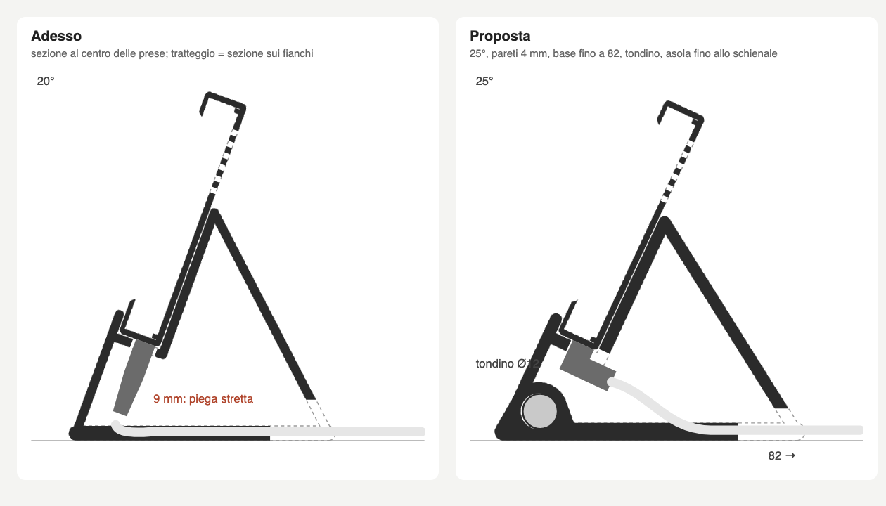

# SPEC scatola: revisione prima della stampa

Claude Design, 5 novembre 2026. Risponde a `design/BRIEF_SCATOLA.md` sulla prima versione di `scatola/scatola.scad`.

## In breve

**La scatola va bene così.** Proporzioni, spessore e raggi sono giusti e non vanno toccati.

**Il supporto tiene la forma ma va cambiato in quattro punti:**
- inclinazione da 20° a 25°;
- pareti da 3 a 4 mm;
- base più lunga dietro, da 72 a 82 mm;
- un tondino d'acciaio come zavorra nell'angolo davanti.

Così, secondo la stima, prima di ribaltarsi regge una spinta più che doppia.

**Cavo:** la spina a L è la scelta consigliata. L'asola del ripiano si allunga fino allo schienale perché la spina ci passi. Il supporto non si alza.

**Colore:** nero opaco.

**C'è un errore nel modello:** gli incavi dei piedini sono chiusi dentro la base (vedi §6.1).

| File | Cosa è |
|---|---|
| `design/scatola/profilo_adesso_proposta.png` | sezione di lato, adesso e proposta, con il percorso del cavo |
| `design/scatola/scatola_proposta.scad` | copia di `scatola.scad` con tutte le modifiche del §6 già scritte e compilate (OpenSCAD, `--backend=manifold`, nessun errore). Basta confrontarla con `diff` e riportarla. |



---

## 1. Aspetto

### 1.1 Cornice: va bene

Bordi visibili attorno allo schermo, misurati sul davanti dopo lo smusso:

| | mm |
|---|---|
| sinistra e destra | 14,5 |
| sotto | 11,5 (circa 6 coperti dal labbro del supporto) |
| sopra | 7,6 |

- Il bordo sopra è più sottile perché la scheda ha il vetro spostato verso l'alto. Si potrebbe pareggiare solo allungando la scatola sopra, ma non ne vale la pena:
  - il labbro del supporto copre il bordo sotto;
  - visti da seduti, sopra e sotto sembrano simili.
- Il bordo sotto più largo fa da "mento", come negli schermi da scrivania.

### 1.2 Spessore e raggi: invariati

- Lo spessore di 14,9 mm è il minimo per la scheda. Visto di lato, sul supporto, sembra un oggetto unico.
- `R_OUT` 5 mm e `R_EDGE` 1,6 mm restano:
  - raggi più grandi farebbero sembrare la scatola un giocattolo;
  - raggi più piccoli la farebbero sembrare una scatola elettrica.
- Lo smusso a 45° della finestra resta com'è. Fa arrivare il dito ai bordi e, in nero, non si vede.

### 1.3 Colore: nero opaco

Il motivo è lo schermo, non il Mac:
- l'interfaccia è scura (#121212) e il vetro ha un bordino nero;
- in nero la cornice si fonde con il bordino, e scompaiono i 0,4 mm di gioco sopra il vetro e gli 0,8 mm di bordino che la finestra lascia vedere;
- in bianco si vedrebbero tutti e due come una riga nera irregolare attorno all'immagine;
- in bianco lo schermo sembrerebbe grigio e spento, soprattutto alla luce del 15%.

In bianco sono anche più visibili polvere, ingiallimento del PLA e linee degli strati sul supporto.

Per la stampa:
- PLA nero **opaco** ("matte"); il PLA lucido mostra molto le linee degli strati;
- la cornice, che si stampa a faccia in giù, viene meglio su un piatto **PEI ruvido**: il davanti prende una grana uniforme, simile a quella dei dispositivi veri.

Accanto a un Mac il nero va bene sia con i modelli neri (Mezzanotte, Nero siderale) sia con l'argento: un accessorio nero accanto a un Mac argento è normale (tastiere, cuffie). Bianco o argento non sono vietati, ma per i motivi sopra la scelta è il nero.

## 2. Supporto: forma

**Il triangolo aperto resta.** Ha l'aspetto di una lamiera piegata, un linguaggio riconosciuto (supporti per tablet e telefoni), non di un pezzo incompiuto. È anche l'unica forma che si stampa coricata su un fianco senza supporti di stampa: chiudendo i fianchi, la parete di sopra diventerebbe un soffitto di circa 35 cm² nel vuoto.

Perché sembri voluto servono due cose, già comprese nel §6:
- **Pareti più spesse:** da 3 a 4 mm, con la base da 5 a 6 mm. Con 3 mm, accanto a una scatola di 15 mm, il supporto sembra un fil di ferro e flette di torsione quando si tocca lo schermo.
- **Un pieno nell'angolo davanti:** il rinforzo del tondino (§3.2), un quarto di cerchio di 20 mm. Il triangolo smette di essere solo un profilo e, visto dal fianco, il foro tondo col tondino d'acciaio sembra un perno, un dettaglio voluto.

Larghezza: i 116 mm restano. La scatola sporge di 12,75 mm per lato e sembra sospesa, che va bene. Un supporto largo quanto la scatola la farebbe sembrare un monitor su un piedistallo.

## 3. Uso col dito e stabilità

### 3.1 Inclinazione e altezza

- **Altezza: 36 mm, invariata.**
  - Il centro dello schermo è a circa 78 mm dal tavolo, giusto per un oggetto che si guarda di sbieco accanto al computer.
  - Alzarlo costa stabilità (vedi la tabella) e allarga il "mento" che si vede sotto lo schermo.
- **Inclinazione: da 20° a 25°.**
  - Da seduti, con gli occhi circa 45 cm sopra il tavolo e la scheda a 50 cm, lo sguardo scende di circa 36°.
  - A 20° lo schermo guarda 16° più in basso dell'occhio; a 25°, solo 11°.
  - La mano arriva dall'alto e il polso si piega meno.
  - La spinta del dito è più verso il basso e meno all'indietro.
  - L'altezza totale scende di 3 mm, a 116 mm.
  - Oltre 25-28° lo schermo riflette le luci del soffitto e il bordo alto si allontana: 25° è il compromesso.

### 3.2 Stabilità

Ho stimato con un modello a leve:
- scatola con la scheda: 160 g;
- supporto in PLA: il peso dipende dalle pareti;
- perno del ribaltamento: il bordo dei piedini posteriori;
- spinta perpendicolare al vetro, sul bordo alto dell'immagine e al centro.

Le cifre sono stime, ma i confronti fra le varianti sono affidabili. Un tocco normale sul touch capacitivo vale 0,3-1 N; un tocco deciso 1,5-3 N.

| Variante | Profondità | Ribalta (tocco in alto) | Ribalta (tocco al centro) |
|---|---|---|---|
| Adesso (20°, pareti 3, base 72) | 92 mm | **1,3 N** | 2,0 N |
| Supporto alzato di 10 mm | 93 mm | 1,2 N | 1,8 N |
| Pareti 4 | 91 mm | 1,4 N | 2,3 N |
| 20°, pareti 4, base 72, tondino | 91 mm | 2,2 N | 3,5 N |
| **Proposta: 25°, pareti 4, base 82, tondino** | **107 mm** | **3,0 N** | **5,1 N** |
| 25°, pareti 4, base 92, tondino | 115 mm | 3,7 N | 6,6 N |

Con la versione di adesso, un tocco deciso in alto lo fa inclinare: il dubbio del brief è fondato.

La proposta tiene il triplo del peso:
- **Zavorra:** un tondino d'acciaio pieno di Ø 12 mm e 112 mm di lunghezza (circa 100 g), infilato in un foro passante nell'angolo davanti, dove la leva è più lunga.
  - In ferramenta lo tagliano a misura; in alternativa va bene una barra filettata M12 (circa 75 g).
  - Il foro corre lungo la larghezza del supporto. Stampando il supporto su un fianco il foro viene in verticale, quindi tondo e senza supporti.
  - Il tondino sta incassato 2 mm per lato. Se balla, basta una goccia di colla.
- **Base più lunga:** dietro arriva a 82 invece di 72. Ho scelto 82 e non 92 perché 107 mm di profondità stanno accanto a una tastiera; 115 cominciano a ingombrare.

**Senza tondino** la proposta regge circa 2 N in alto, già meglio di adesso. Il tondino è consigliato ma la stampa non dipende da lui.

## 4. Cavo: spina a L, supporto non alzato

Con una spina dritta (render 8) restano 9 mm sotto la spina e il cavo piega quasi ad angolo vivo. Alzare tutto di 1 cm risolve il cavo ma peggiora la stabilità e allarga il mento. La soluzione migliore è la **spina a L**:
- **Cavo da comprare:** USB-C con spina **a 90° "su/giù"**, cioè con il cavo che esce perpendicolare alla faccia larga della spina. USB-C si inserisce nei due versi: si gira in modo che il cavo vada **verso il retro**.
  - Le spine "sinistra/destra" non vanno bene: il cavo correrebbe lungo il bordo della scatola, sopra il ripiano.
  - Meglio un cavo nero, perché il cavo si vede dai fianchi aperti.
- **Modifica al supporto:** l'asola del ripiano oggi è grande quanto le due spine. Va allungata all'indietro, attraverso l'angolo fra ripiano e schienale, fino a 6 mm dietro lo schienale, e in giù fino a 16 mm sotto la scatola. Il corpo della L passa lì, e il cavo scende nel triangolo con una curva larga (vedi il disegno).
  - L'asola mantiene la larghezza di oggi, 32,8 mm, e lascia 33 mm di ripiano a sinistra e 50 mm a destra.
- **Spina dritta:** resta possibile come oggi, con la piega stretta.
- **Uscita dietro:** la finestra di adesso, 30 × 14 mm, è più grande del necessario e si vede nel render 2. Diventa un arco **16 mm di larghezza × 10 mm di altezza**, con la cima arrotondata (R 4).
  - Ci passano due cavi da 4 mm.
  - L'arco è aperto verso il tavolo: il cavo si infila da sotto alzando il supporto, senza far passare la spina dall'altra parte.

## 5. Uso del labbro

Il labbro davanti alla scatola sale 6 mm sulla cornice e sporge 3,4 mm in avanti. Fra il labbro e l'immagine restano 5,5 mm: toccando l'ultima riga dello schermo (le schede piccole della Home sono lì) il polpastrello lo urta. Va abbassato da **6 a 4 mm**:
- la scatola è tenuta dalla gravità contro lo schienale, e 4 mm bastano perché non scivoli in avanti;
- lo spazio libero sale a 7,5 mm.

## 6. Modifiche in numeri (`scatola.scad`)

Tutte già scritte in `design/scatola/scatola_proposta.scad`.

### 6.1 Errore da correggere: piedini

`bar(front, rear, ST_T + 2)` ha il centro a z = `ST_T/2`, quindi la base va da **z = -1** a 4. Gli incavi dei piedini partono da z = -0,01: sono **cavità chiuse dentro la base**, che lo slicer riempie o lascia vuote, e i piedini non hanno dove stare (lo STL attuale ha il minimo a z = -1,0).
- **Correzione:** `translate([x, u, -1.01]) cylinder(d = 10.5, h = 1.0)`.
- Il ripiano resta a 37 mm dal fondo della base e la scatola a circa 39 mm dal tavolo con i piedini: va bene così, non serve spostare altro.

### 6.2 Parametri

| Parametro | Adesso | Nuovo |
|---|---|---|
| `TILT` | 20 | **25** |
| `SHELF_H` | 36 | 36 (invariato) |
| `ST_W` | 116 | 116 (invariato) |
| `ST_T` | 3,0 | **4,0** (base 6) |
| `FOOT_U` | 72 | **82** |
| `REST_T` | 50 | 50 (invariato) |
| labbro, `g(-c, 6)` | 6 | **`LIP_H` = 4** |
| `ROD_D` (nuovo) | | **12**, foro Ø 12,4 passante |
| `BOSS_D` (nuovo) | | **20** |

### 6.3 Rinforzo e foro del tondino (nel `linear_extrude` del supporto)

```
zb   = BOSS_D / 2 - 1;   // centro del tondino: 9 mm sopra il fondo della base
boss = [front[0] + (zb - ST_T / 2) * tan(TILT) + (BOSS_D / 2 - ST_T / 2) / cos(TILT), zb];
hull() { translate(boss) circle(d = BOSS_D); translate(front) circle(d = ST_T + 2);
         translate([boss[0] + BOSS_D / 2, ST_T / 2]) circle(d = ST_T + 2); }
```
Il cerchio è tangente al davanti, quindi la faccia esterna del supporto resta dritta.

Foro: `translate([-ST_W/2 - 1, boss[0], boss[1]]) rotate([0, 90, 0]) cylinder(d = ROD_D + 0.4, h = ST_W + 2)`.

### 6.4 Asola per la spina a L (al posto della sola asola del ripiano, che resta)

È un prisma largo `sw = USB_X - UART_X + PORT_W + 2` (32,8 mm), centrato su `slot_x`. In coordinate scatola (s, t) va:
- per s, da `T - PORT_Z - (PORT_H + 2)/2` a `T + c + ST_T/2 + 6`;
- per t, da +1 a -16.

### 6.5 Uscita dietro

Arco 16 × 10 mm: due cerchi R 4 con il centro a 6 mm d'altezza, uniti alla base. Sostituisce `cube([30, 40, 14])`.

### 6.6 Scatola (cornice e retro)

Nessuna modifica.

## 7. Altri ritocchi prima di stampare

- **Viti:** la M3×10 arriva a 0,4 mm dall'interno del fronte (punta a z 13,0, fronte interno a 13,4) e lavora per 4,8 mm nella colonnina: va bene. Usare **M3×8 o M3×10, mai M3×12**, che sbucherebbe dal davanti della cornice (z 15,0, fronte a 14,9).
- **Prova di stampa:** prima del supporto intero conviene stampare una **striscia di 20 mm** di supporto (`ST_W = 20`), per controllare:
  - il foro del tondino;
  - il passaggio della spina a L;
  - il labbro sulla cornice.

  Sono circa 40 minuti invece di 5 ore.

## 8. Da verificare con i pezzi in mano

1. **Ribaltamento:** con la scatola sul supporto e il tondino montato, premere con un dito in alto al centro dello schermo, deciso come per un tocco nervoso. Non deve alzarsi. Se si alza: `FOOT_U` 92 (+8 mm di profondità).
2. **Angolo:** da seduti nella posizione solita, controllare che a 25° lo schermo non rifletta la lampada o la finestra. Se riflette, provare 22°: basta cambiare `TILT`, il resto si adatta.
3. **Cavo a L:** con la spina inserita verso il retro, la scatola deve appoggiare piatta sul ripiano senza che la spina la sollevi.
4. **Bordino del vetro:** guardando lo schermo acceso con un'immagine chiara, non deve vedersi nessuna striscia del bordino nero lungo un solo lato. Se si vede, la scheda è spostata nella tolleranza: si sposta di 0,3 mm `WIN_M` da quel lato.
5. **Labbro:** con il dito, toccare un elemento dell'ultima riga della Home (le schede piccole) senza urtare il labbro.
