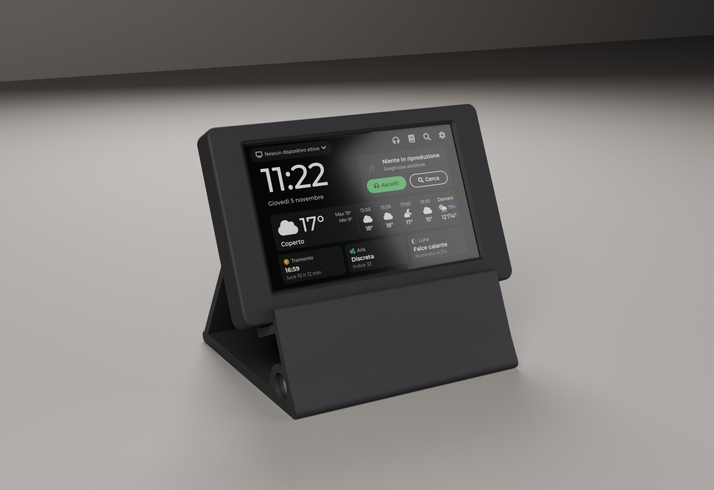

# Scatola stampata in 3D

Versione del 5 novembre 2026, rivista da Claude Design (`design/scatola/SPEC_SCATOLA.md`). Non ancora stampata né provata con la scheda vera.



## Pezzi

| File | Cosa è | Come si stampa |
| --- | --- | --- |
| `stl/cornice.stl` | Fronte con la finestra dello schermo e i quattro lati | A faccia in giù, senza supporti |
| `stl/retro.stl` | Coperchio posteriore con le colonnine delle viti | A faccia in giù (bordino verso l'alto), senza supporti |
| `stl/supporto.stl` | Leggio da scrivania, schermo inclinato di 25°, con il foro per il tondino di zavorra | Coricato su un fianco, senza supporti (il foro del tondino viene in verticale) |

Materiale: PLA nero **opaco** ("matte") o PETG, strati da 0,2 mm, 3 perimetri, riempimento 20%. La cornice viene meglio su un piatto PEI ruvido: il davanti prende una grana uniforme.

Prima del supporto intero conviene stampare una striscia di prova larga 20 mm (`-D ST_W=20`, circa 40 minuti invece di 5 ore) per controllare il foro del tondino, il passaggio della spina a L e il labbro sulla cornice.

Minuteria:
- 4 viti M3×10 (o M3×8) a testa cilindrica: entrano dal retro, passano nei fori della scheda e si avvitano nelle colonnine della cornice. **Mai M3×12**: sbucherebbero dal davanti. In alternativa, viti M3 con inserti filettati a caldo da 4 mm.
- 4 piedini adesivi in gomma da 10 mm sotto il supporto, perché non scivoli.
- 1 tondino d'acciaio pieno Ø12 mm lungo 112 mm (circa 100 g), da infilare nel foro davanti del supporto come zavorra. In ferramenta lo tagliano a misura; va bene anche una barra filettata M12. Se balla, una goccia di colla.
- Un cavo USB-C nero con la spina **a 90° "su/giù"** (il cavo esce perpendicolare alla faccia larga della spina), da inserire con il cavo rivolto verso il retro. In alternativa un adattatore USB-C maschio → femmina a 90° "su/giù" (ad esempio PremiumCord, Amazon B0C9TD16NP) con un cavo dritto qualsiasi che porti i dati; la parte vicino alla spina deve stare entro 12 × 6,5 mm. Va bene anche un cavo USB-C ↔ USB-C: la scheda ha le resistenze CC da 4,7 kΩ su tutte e due le prese (schema `Schematic/5.0.png` del repository VIEWE), quindi il Mac e i caricatori USB-C la alimentano. Una spina dritta entra lo stesso, ma il cavo piega stretto.

## Misure

Le misure della scheda vengono dal disegno ufficiale VIEWE (`UEDX80480050E-WB-A V3.3 SPEC`, pagina 12), con tolleranza ±0,3 mm:
- circuito 136,73 × 83,70 mm, spessore 1,6 mm;
- fori Ø3,2 mm a 3,5 mm dai bordi;
- vetro alto 4,8 mm sopra il circuito.

| | Misura |
| --- | --- |
| Scatola | 141,5 × 88,5 × 14,9 mm |
| Con il supporto | circa 142 × 107 × 116 mm (larghezza × profondità × altezza) |

Scritta "Er_Chiacchiera" incisa per 0,6-0,8 mm, in Montserrat come l'interfaccia (`font/`, licenza OFL in `font/OFL.txt`):
- sul bordo superiore della scatola, leggibile guardando dall'alto dal davanti;
- sulla parete posteriore del supporto, sopra l'uscita del cavo, leggibile da dietro.

Il testo si cambia in cima a `scatola.scad` (`LABEL`).

Aperture:
- **in basso**: le due prese USB-C (UART a sinistra, USB a destra) e due forellini per premere *boot* e *reset* con una graffetta;
- **a destra**: la fessura della microSD, con un incavo per il dito;
- **dietro**: feritoie sopra il modulo ESP32.

Il bordo inferiore della scatola sta 36 mm sopra il tavolo. La spina a L passa nell'asola del ripiano, che continua fino allo schienale; il cavo scende dentro il supporto, corre sul fondo ed esce dietro da un arco di 16 × 10 mm aperto verso il tavolo (il cavo si infila da sotto, senza far passare la spina).

## Da controllare con la scheda in mano

- Guardando lo schermo dritto, le prese USB devono stare **sotto**. Se fossero sopra, il disegno va girato.
- Il bordino nero attorno all'immagine deve restare tutto coperto dalla cornice. Il fronte la tiene a 0,4 mm dal vetro: se balla, si mette una striscia di gommapiuma sottile.
- Con il tondino montato, un tocco deciso in alto al centro dello schermo non deve far alzare il supporto (stima: regge 3 N, prima 1,3). Se si alza: `FOOT_U` 92.
- Da seduti, a 25° lo schermo non deve riflettere la lampada o la finestra. Se riflette, provare `TILT` 22.
- Con la spina a L inserita verso il retro, la scatola deve appoggiare piatta sul ripiano.
- Toccando l'ultima riga della Home il dito non deve urtare il labbro del supporto.
- L'elenco completo è nel §8 di `design/scatola/SPEC_SCATOLA.md`.

## Rifare i file

```bash
openscad -D 'part="cornice"' -o scatola/stl/cornice.stl scatola/scatola.scad
```

Per gli altri pezzi basta cambiare `cornice` in `retro` o `supporto`. Le misure sono in cima a `scatola.scad`.

I render si fanno con Blender: prima si esportano i pezzi in posizione (`-D posa=true`, in `scatola/prove/posa/`), poi:

```bash
/Applications/Blender.app/Contents/MacOS/Blender -b -P scatola/render_blender.py -- nero
```

Dopo il colore si possono scrivere i numeri delle inquadrature da rifare (ad esempio `-- bianco 5 6`):
1. davanti;
2. dietro;
3. di lato;
4. pezzi separati;
5. scatola chiusa vista da dietro, senza supporto;
6. bordo con le prese, visto da sotto;
7. cavo che esce dal retro del supporto;
8. percorso del cavo dentro il supporto, visto di lato;
9. scritta sul bordo superiore;
10. scritta sul retro del supporto.

Nei render il cavo è quello consigliato (nero, spina a L) e il tondino è montato.
